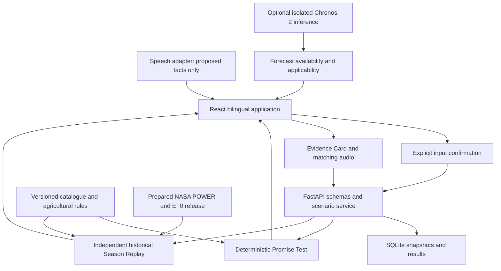

# MISSION EL GHEET — Architecture

**Read this if…** you need the system boundaries, the user journey/revision model, or the milestone order.

Status: Approved  · Owner: Yahya. Last reviewed .

Wire contracts: [api-contracts.md](api-contracts.md). Implementation map: [backend-design.md](backend-design.md). Progress: [status](../status/backend.md).

## Authority and scope

The unchanged [PRODUCT.md](../product/product.md), [SCIENCE.md](../science/science.md), [DATA_SPEC.md](../science/data-spec.md), [ML_EXPERIMENT.md](../ml/ml-experiment.md), [REFERENCE_SCENARIO.md](../product/reference-scenario.md) and [HANDOFF.md](../archive/handoff-.md) govern product and scientific meaning. The handoff confirms Sakha despite earlier pending-locality wording. The subsequent architecture approval resolves the handoff's pending architecture/stack wording; it does not resolve scientific uncertainty.

Preserve all seven product requirements, all four catalogue crops, Egyptian Arabic/English voice interaction, and the trained-ML workstream. Feasibility under applicable rules and explicit assumptions is not proof of field performance. Farmer approval is not scientific verification.

## System and boundaries

One modular backend serves the application. Planner logic does not call speech, NASA, replay or ML services. Replay cannot change planner eligibility or locks. Forecasting cannot validate a rotation or silently edit a plan.

| Boundary | Responsibility |
|---|---|
| Frontend app and features | Intake, confirmation, timeline, alternatives, replay, forecast status, Evidence Card and recovery. |
| API and Pydantic schemas | Validate requests/responses, normalize errors, enforce version references and generate OpenAPI. |
| Scenario service | Atomic confirmed snapshots, commitment changes, persistence, approval/revocation and invalidation. |
| Planner | Pure deterministic rule evaluation, bounded candidate enumeration and rule-linked explanations. |
| Catalogue loader | Validate crop/purpose/profile IDs, applicability, source locators and unresolved evidence. |
| Replay and calculations | Common historical mapping/coverage, paired metrics, versioned ET0 and conditional ETc. |
| Forecast adapter | Validate optional model outputs, provenance, issue/cutoff/target dates and relevance. |
| Speech adapter | Consent-aware recognition and playback; recognition creates unconfirmed proposals only. |
| Evidence service | Assemble exact snapshot/result references and authored bilingual takeaway content. |

The approved module layout, runtime data release, SQLite schema, ML forecast-bundle interface and voice/bilingual design are in [BACKEND_DESIGN.md](backend-design.md) (). The "optional isolated Chronos-2 inference" box is realised as an offline `ml/` pipeline that writes a validated `forecast_bundle.json`; the backend never runs model inference.

Keep explicit Python rule evaluators keyed by stable rule IDs, with versioned catalogue metadata. Do not execute arbitrary catalogue expressions or introduce a general rule/workflow engine.

## Approved technology and storage

- React, TypeScript, Vite and Tailwind; final design system awaits the dedicated Astra UI/UX session.
- React reducer/context for journey state and a small typed API boundary. Add state libraries only for demonstrated need.
- FastAPI/Pydantic; executable Pydantic schemas generate committed OpenAPI and frontend types after implementation authorization. Do not maintain duplicate handwritten API models.
- SQLite through a small repository layer. Store scenario revisions, immutable plan snapshots, result manifests, approvals and evidence snapshots. Use ordinary transactions and expected-revision checks, not event sourcing.
- Immutable JSON catalogues/manifests and normalized CSV scientific releases outside SQLite. Preserve hashes, source metadata, units and calculation versions.
- PyTorch/Chronos-2/LoRA in an isolated environment/process. The core backend must start without model packages, weights or GPU access.

No database server, Kubernetes, microservice fleet, queue broker or user-account system is required for the controlled local prototype. Browser storage is a recoverable draft cache, never proof of a server save. Large weather files, audio and model weights do not belong in scenario rows.

## Journey and revisions

1. Pictures, touch, text or speech produce proposed facts. Unknowns remain explicit.
2. Read/spoken confirmation submits a complete input snapshot. Recognition and silence cannot confirm it.
3. Promise Test evaluates that immutable snapshot. Display current-plan violations and missing evidence together.
4. Enumerate only permitted changes. Offer at most two meaningfully distinct feasible alternatives; expose review investigations separately. Date-only changes are timing variants.
5. Selecting a candidate creates a working draft. Confirm and evaluate the new revision before approval.
6. Replay adds historical evidence only where inputs support it. Missing weather or coefficients must not prevent saving intentions and unresolved checks.
7. Explicit approval can attach to a current feasible plan. Rejected/review-required intentions can be saved as review drafts. Card and spoken takeaway reference the same plan and evidence versions.

Use a scenario revision for all material inputs, including soil, area, water, dates, crop purpose, locks and priorities. A plan version identifies the corresponding four-season snapshot. Results record both plus dependency versions. Material edits immediately mark the UI unconfirmed; accepting a new revision invalidates dependent approval on the server. Old records remain historical, not current. A language switch alone changes presentation, not facts.

Each write checks the expected revision in the same SQLite transaction as its update. Each response is applied only to its matching active revision; cancellation alone does not protect against late responses. Stop old audio on material edits. Idempotency protects retried confirmations and approvals. Dependency-version changes require reevaluation before current approval; never rewrite old evidence silently.

## Planner and scientific integration

Adopt the SCIENCE interval convention: occupation is sowing-inclusive/release-exclusive, and next sowing must be at least release plus preparation days. Unknown preparation is not zero. Crop end and field release remain separate because removal can take time. A changed sowing date invalidates unsupported old maturity/release dates.

Classify demonstrated hard violations as `rejected`; otherwise unresolved required checks as `needs_review`; otherwise `feasible`. Return uncertainty even alongside rejection. Guidance such as May preference is not a biological June prohibition. Missing Kc blocks ETc, not automatically planning feasibility. Missing critical release/applicability evidence blocks feasibility.

Candidate search is finite and deterministic: farmer-permitted crop/date choices, hard constraints first, declared priorities, minimal unnecessary edits, meaningful distinctness, then stable ID/date ordering. No aggregate best-farming score. Report search limits and incomplete coverage; zero found is not a proof that every conceivable repair is impossible.

Replay follows SCIENCE: preserve month/day and relative year offsets, recompute endpoints from applicable profiles, rerun mapped feasibility, and use identical consecutive historical blocks across compared plans. Exclude unrepresentable explicit leap dates for all compared plans and report exclusions. Missing data policy and mapping/calculation versions are part of every result. Retain paired within-block differences, spread, durations, commitments, crop-free intervals and sourced sequence indicators. A conflicted baseline stays labelled hypothetical; it cannot support achievable-savings claims.

Keep the exact method label **FAO56 ET0 with the ASCE daily cloudiness bound**. No invented Kc, stages, heat thresholds, yield, irrigation savings or soil benefit. ETc remains unavailable without applicable sources; ET0 remains reference atmospheric demand. Preserve NASA LST day labels, raw precision and source geometry. Live NASA access is unnecessary for the core demo once a verified prepared release is packaged.

## Acceptance scenarios and priority research

UH-001 must produce P0 rejected, the 20 May 2027 berseem cut preserved, R1/R2 needing review, zero feasible alternatives and a forecast inapplicable to the months-ahead decision. Under the declared release/preparation assumption, 28 May is calendar-compatible, not a validated planting recommendation. No later collision is invented. Completion is a saved review-required draft.

A second evidence-supported scenario with at least one feasible alternative is a **high-priority research and demonstration goal**, owned by Refaat with Karim/Yahya and Amr. Establish complete four-season inputs, applicable locality/cultivar/soil/water conditions, release/preparation and shifted maturity mappings, locks and permitted edits. Prefer a small supported change over inventing a successful rotation. Resolve every critical feasibility gate before presenting the alternative as feasible. Synthetic algorithm fixtures remain explicitly synthetic and never become verified agricultural advice. Failure to obtain evidence is reported, not hidden by changing UH-001.

The trained-ML experiment remains required even though serving is optional. Preserve the finding that seasonal climatology outperformed the fine-tuned model in the recorded assessment. Future work needs a bounded protocol, strong baselines, fresh evaluation dates, uncertainty criteria and an eligible near-term decision. Consumed assessment dates are not a fresh test. Existing training success does not establish forecast or farmer benefit. No new training is authorized by this document.

## Frontend and speech

Separate working inputs, confirmed server snapshots and presentation state. Keep the existing feature-directory structure. Shared selectors derive validity/currentness instead of duplicating result state across screens. Fixtures validate against the same contract as the live backend and are visibly labelled; network failure never silently switches to successful mocks.

Use semantic timeline markup, crop pictures with spoken names, large controls, explicit date/lock edits, keyboard alternatives, focus recovery and reduced motion. Dragging cannot be the only input method or silently confirm a change. Arabic RTL and English LTR have equivalent meaning and functionality; use logical layout properties and explicit chronology/date labels. Design loading, empty, unavailable, stale, microphone-denied, interrupted-audio and save-failed states in the later UI session.

Start provider feasibility testing early once authorized, in parallel with the first slice. Test actual devices, Egyptian Arabic crop names, negation, complete dates, units, interruptions and correction. Provider selection and paid services require approval; do not claim live reliability before testing. Use authored bilingual explanation templates, recorded prompts where practical, and an interruptible audio controller. Pictures/audio, typing and adviser assistance preserve recovery; they do not prove independent no-reading usability. Label cached/recorded demonstrations both visually and audibly.

## Integration ownership and milestones

| Owner | Deliverable and interface |
|---|---|
| Amr | Frontend/UI supervision, revision-aware integration and bilingual acceptance; ML with Refaat. |
| Karim | Planner, agricultural-rule evaluation, candidate search and constraint tests. |
| Yahya | API, SQLite/revisions, replay integration and service recovery. |
| Refaat | Scientific data/source releases, numerical fixtures, crop-evidence gates, second scenario and ML with Amr. |
| Moaaz | Pictures, motion/storytelling and demo video tied to actual evidenced results. |

Karim/Yahya maintain schemas; Amr reviews consumer/state changes; Refaat reviews scientific fields. Change schemas, generated types, fixtures and consumers together. Use short-lived focused branches, separate checkouts/worktrees and reviewed PRs into a runnable main branch. Integrate frequently at small, testable milestones. Vite proxies `/api` to FastAPI locally; all developers use the same labelled fixture/data release. No commits or pushes are implied by planning approval.

After visual approval and implementation authorization, follow these dependency-based milestones:

| Order | Acceptance |
|---|---|
| 1: first working slice | Five domain endpoints from API_CONTRACTS; confirmed UH-001 input → real backend Promise Test → bilingual UI conflict, protected cut and zero alternatives. Generated contracts and runnable shell. |
| 2: changes and candidates | Four-season edits, review investigations, stale-response protection and invalidation; supported feasible case only if research gates pass. |
| 3: historical evidence | Prepared release, reproducible paired replay, numerical checks and honest unavailable metrics. |
| 4: accessible completion | Tested speech integration/recovery, Evidence Card, matching audio, persistence and revocation. Speech feasibility research starts at milestone 1, not here. |
| 5: optional serving and rehearsal | Forecast availability integration, preserved experiment findings, real-device checks, local/remote rehearsal and evidence-reviewed video. |

Milestones are dependency gates, not fixed-duration commitments. Prioritize the first real working slice before expanding to additional screens.

## Deployment, security and verification

Local demo: built frontend and FastAPI on the demo laptop, persistent SQLite, prepackaged verified data/assets, optional separate ML process. Rehearse with speech, NASA and ML unavailable. A browser refresh can restore saved state; complete offline speech/browser capability is not promised.

Remote demo: use the same built frontend/API on one HTTPS host with a persistent volume for SQLite and prepared data, one application instance initially. No GPU is required. Keep public demonstration sessions isolated using server-issued session scope, secure cookies, expiry and per-session record authorization; include CSRF/origin protection for cookie-authenticated writes. Shared immutable fixtures are read-only; visitor edits create isolated copies. Restrict the public demo to synthetic scenarios and disable real farmer recordings/records by policy and interface. Public record IDs alone confer no access. Choose host, retention duration, limits and provider configuration before deployment; hosting and deployment remain unapproved. An ephemeral filesystem is not a durable-save strategy.

If remote hosting cannot be completed, use a controlled live screen-share of the local application; label prerecorded footage honestly. This preserves a practical remote demonstration without pretending public interactive hosting exists.

Validate input sizes/types, bound search and audio duration, use request timeouts/rate limits, keep secrets outside source/browser, and avoid logging raw audio/transcripts. No retained raw recordings by default. Disclose speech transmission and request microphone consent before capture. Pin dependencies and review security alerts. Back up SQLite and versioned data before deployment changes; use disposable synthetic sessions for rehearsal.

Required checks: planner hard/unknown/boundary cases; UH-001; honest synthetic versus evidence-backed scenarios; shared replay periods/leap policy; audited ET0 values/units and missing Kc; forecast cutoff/staleness/failure; schema/fixture/client consistency; stale requests and failed/revoked saves; Arabic/English semantics; microphone denial/interruption; actual mobile/browser journey and reduced motion. CI runs backend tests/lint/type checks, frontend tests/lint/type checks/build, contract drift and a small real-backend browser suite. GPU/full artifact reproduction is targeted to relevant changes. Report unexecuted checks explicitly.
