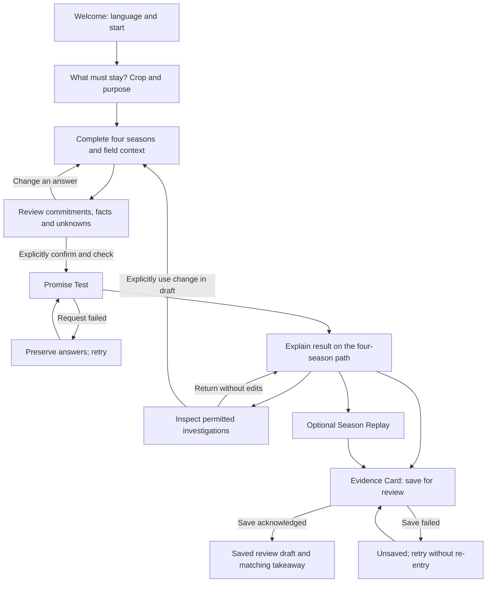

# Season Path — Phase 1 experience review

**Read this if…** you need the reasoning behind the journey flow and its five refinements.

Status: Approved  · Owner: Amr. Last reviewed .

Specification-based UX review (not interview research or usability testing). Phase 1 was approved and Phase 2 wireframes authorised on 11 Nov.

Approved refinements: commitment-first is optional, with a natural crop-first start and no compulsory lock; reveal seasons progressively; distinguish rejected, needs-review, feasible, unknown-data and saved-draft states; combine playback and touch within each question; keep NASA Season Replay optional, discoverable and meaningful. Phase 2 is presented in the [interactive wireframes](../../work/ux-phase-2/season-path-wireframes.html), with a mobile Arabic RTL journey, desktop adaptation and a separate state sheet. Visual review must precede Phase 3.

Authority: [PRODUCT.md](../product/product.md), [REFERENCE_SCENARIO.md](../product/reference-scenario.md), [DESIGN.md](design.md), [API_CONTRACTS.md](../backend/api-contracts.md), [ARCHITECTURE.md](../backend/architecture.md) and [FRONTEND_MILESTONE_1.md](../archive/frontend-milestone-1.md). Scientific boundaries follow SCIENCE, DATA_SPEC and ML_EXPERIMENT. These proposals do not amend approved contracts. The latest user request adds user-flow and wireframe review before visual refinement and any implementation; the earlier implementation sequence must wait for those reviews and its existing authorization gates.

## 1. Whose problem are we solving?

Uncle Hussein is a fictional illustrative persona. His specified need is to retain berseem for livestock through the final cut on **20 May 2027**, retain grain maize in season 2 and grain wheat in season 3, and understand permitted changes across one field and four seasons. He needs pictures and spoken guidance. His exact age, literacy level, device, income, hearing, household roles and attitudes have not been researched; do not invent them.

His practical question is: **“What can change without losing the cut I need?”** The interaction should answer that before asking him to understand planning terminology or weather metrics.

Success for UH-001 means Hussein can explain what remains protected, why 15 May maize conflicts with 20 May berseem, why the investigated dates still require review, and whether his review draft was actually saved. It does not mean producing an approved planting plan. Preserving a cut in the plan does not guarantee sufficient feed.

Secondary needs within scope:

- A farmer who prefers touch, cannot grant microphone permission, or wants to correct recognition can complete the same decisions without typing.
- A farmer who does not know soil measurements, water delivery or harvest dates can state that uncertainty without guessing.
- A helper can read or operate controls alongside the farmer, while the farmer retains decision authority. Assistance is recorded separately during research; there is no implied adviser booking or messaging service.
- An extension engineer can inspect exact facts, assumptions, reasons and sources from the same Evidence Card. A separate dashboard or account role is unnecessary.
- An English-speaking reviewer can follow identical facts and status meanings. Switching language must not restart intake.

Design hypotheses to test, not persona facts: commitment-first intake may improve relevance; short question groups may reduce recall burden; a vertical path may make season order clearer; specific action labels may reduce confusion between acknowledging facts and accepting advice. Noise, glare, limited connectivity and one-handed use are testing conditions, not claimed observations about Hussein.

## 2. Preserve the identity; challenge the interaction

Keep crop photographs, short Egyptian Arabic prompts, four connected seasons, the precise conflict inset, warm agricultural storytelling, and the Evidence Card's explanation hierarchy. Keep Show, Speak, Choose, Confirm. Do not replace them with a dashboard or unrestricted chatbot.

| Existing risk | Proposed improvement | Cost or boundary |
|---|---|---|
| Language selection, listening and starting can feel like three setup tasks | Keep both language choices visible; start in the chosen language with one clear action. Listen remains available, never required before Start | No microphone permission at entry; no assumed audio autoplay |
| A generic crop picker loses Hussein's reason for coming | Begin with “What must stay?” and the relevant crop/purpose; use those answers to populate the path | A crop selection is an intention, not suitability approval |
| Voice mode versus touch mode adds an unnecessary decision | Offer picture choices and “Speak your answer” on the same question | Both routes produce the same unconfirmed fields |
| Repeating every recognized fact as a fresh question wastes effort | Populate proposed facts from the utterance; ask only for missing or ambiguous meaning | Complete readback still precedes explicit confirmation |
| A confirmation dialog after every tap creates fatigue | Selection plus Continue advances intake; grouped review culminates in one explicit confirmation of the complete snapshot | Protection choices stay visible; post-confirmation lock changes remain a separate gated flow |
| Collecting every technical field as a separate question feels like a form wall | Group by crop/season, field, water and commitments; offer a short route to explicitly unknown measurements | Do not omit required keys, default unknowns, or conceal limitations |
| Lock icons suggest success or guaranteed yield | Pair the symbol with “Protected by your choice” and read the retained value | Keep protection independent of feasibility |
| “Promise Test” may sound like a guarantee | Retain the identity as a secondary name; lead with “Check whether these dates conflict” | The full test also reports unresolved agricultural checks |
| Date cards resemble recommendations | Separate “Dates to investigate” from supported feasible alternatives; lead each with needs-review meaning | No preselection, best badge or green success treatment for R1/R2 |
| Every feature becomes a compulsory chapter | Make the core route intake → check → explanation → review takeaway; offer investigations and historical weather as branches | Replay remains discoverable; no feature is removed |
| “Saved” can be mistaken for “approved” | Use separate statements for plan status and save status | Never restyle rejected P0 as needs_review merely because it is a review draft |
| Date selectors can become long, repetitive lists | Let speech populate proposals; for touch, retain named month/day/year choices, current-value correction and complete-date readback | No assumed year, calendar-only entry or unapproved conversion |

## 3. Main journey and decision flow

The seven requested experiences remain, but they need not be seven mandatory pages. The four-season path is a persistent reference that grows during intake and becomes the review surface. Detailed layout belongs to Phase 2.

This depicts Hussein's review-draft route. A future current feasible result may expose separate explicit approval under the existing contract; that branch must not appear for UH-001.

| Experience | Farmer's task and proposed interaction | Exit condition / next step |
|---|---|---|
| Welcome | Understand this is an illustrative crop-planning prototype; select العربية or English; start or hear an introduction | Language is known; audio permission is not a prerequisite |
| Crop selection | Identify what must stay, beginning with berseem and its livestock purpose; complete remaining crop intentions through photos, names and speech | Exactly four season positions exist; unanswered fields remain visibly unresolved, not silently confirmed |
| Context intake | Ask relevant dates, area/unit, release/preparation, soil, water, production needs and permitted changes in short groups | Every material fact has a value or explicit unknown reason; unknown cultivar remains unresolved, never guessed from a photo |
| Protected commitment confirmation | Read back the 20 May 2027 cut, maize grain and wheat grain locks; explain that protection constrains edits, not crop performance | Farmer checks groups, can correct answers, then explicitly confirms the full snapshot and requests the test |
| Four-season journey | Inspect crop, purpose, dates and protected facts across numbered seasons; expand one season at a time | Review does not require horizontal scrolling; Change returns to the relevant answer with context preserved |
| Promise Test | Hear the demonstrated conflict first, then retained commitment and next available actions | P0 remains rejected; unresolved checks are also present; no automatic replacement |
| Season Replay | Optionally hear what historical weather can and cannot show; inspect available evidence or its absence | Return to the exact plan being inspected or continue to review takeaway; weather failure never blocks saving intentions |
| Evidence Card | Hear plan status, preserved commitments, conflict/changes and outstanding checks; save for review | Actual save acknowledgment produces saved wording; matching audio describes the same version and status |

### Hussein's exact walkthrough

1. His opening sentence can propose berseem for livestock, a 20 May cut, grain maize next and wheat afterwards. Ask for the year; do not treat “twenty May” as 2027 automatically. Surface season 4 and any unspoken purpose as missing information. In the fixed demo, disclose every supplied illustrative value rather than pretending Hussein said it.
2. Review the full fixture: berseem → grain maize → grain wheat → grain sorghum; all dates, the one-hectare field, seven preparation days, unknown soil/water/quantity facts and permitted investigations. Preserve exact fixture intentions; do not import trial soil as his soil. The full values remain in REFERENCE_SCENARIO rather than a duplicate fixture here.
3. Confirm protection and the complete input. Illustrative origin stays illustrative even after confirmation. An early working selection is not a server-confirmed commitment.
4. Lead the result with: maize sowing **15 May 2027** falls before the protected berseem cut **20 May 2027**, on the same field. The system retains the cut.
5. Explain **21 May assumed release + seven full preparation days = 28 May 2027** only after the core conflict is understood. This arithmetic does not establish a suitable sowing date.
6. State that there are **zero validated feasible alternatives**. If candidate results exist, offer inspection of 28 May and 1 June as separate needs-review investigations. Never generate the unsupported season-4 maize replacement to fill space.
7. When inspecting a date, explain what stays, what changes and what becomes unknown. Changed maize harvest/release cannot inherit the old endpoints as supported dates. Later crop intentions remain visible; later checks need reevaluation, not invented collisions.
8. Hussein can decline both investigations and save rejected P0 for review. If he explicitly adopts a date into a working draft, reconfirm and reevaluate before presenting it as the current result. Simply opening a comparison changes nothing.
9. Historical evidence is optional; the seven-day forecast is not applicable to this months-ahead choice. Save the review card with actual status and unresolved checks, then offer its matching spoken takeaway.

## 4. User stories and observable acceptance

These are proposed acceptance cases, not executed results. FR references map to PRODUCT.

| ID / story | Acceptance criteria |
|---|---|
| US01 — As Hussein, I want to begin in a language I understand (FR-01) | Both languages have named controls and an accessible start action. No microphone prompt occurs before choosing speech. Switching language preserves all facts and stops old-language audio |
| US02 — I want to choose crops without typing (FR-01/02) | Photo, visible name and spoken identity are available. Crop and purpose are distinct; grain versus forage is explicitly established. Unknown identity/purpose is represented honestly rather than substituted. Choosing a crop does not imply recommendation permission |
| US03 — I want the system to understand what cannot change (FR-02/03) | The cut date includes day, month and year; crop/purpose commitments are named. Separate explicit confirmation follows readback. “Protected” never means sufficient feed or guaranteed harvest. Initial confirmed locks cannot be edited through an ordinary Change control |
| US04 — I want to answer honestly when I do not know (FR-02) | “I don't know” is a first-class answer, read back as unknown. Unknown salinity/preparation is not zero. Unknown dates remain unknown. A grouped “I have no measurements” answer identifies and confirms each affected unknown without treating a farmer report as a lab measurement |
| US05 — I want to understand all four seasons without losing my place (FR-02/03) | Seasons are numbered and labelled with years. Mobile order stays top-to-bottom in both languages; desktop begins at the language's reading start. Back restores the prior question/selection. An incomplete plan is not presented as evaluated |
| US06 — I want to know why my dates conflict (FR-03) | P0 is rejected; the explanation names 15 and 20 May 2027, the same field and protected cut. Release/preparation are labelled assumptions. Unresolved checks remain visible alongside the conflict; no season-2→3 or season-3→4 conflict is invented |
| US07 — I want to inspect changes without accidentally accepting them (FR-03/04) | Inspecting R1/R2 preserves P0. Each investigation states needs review before its date/action. Adoption requires a named draft-change action, full confirmation and reevaluation. All locks persist. Zero feasible alternatives has a useful explanation and continuation route |
| US08 — I want past weather explained without mistaking it for advice (FR-05/06) | Historical dates, source and units accompany available metrics; unavailable values have reasons, never zero. ET0 is distinguished from irrigation use; unsupported ETc and heat-risk claims are withheld. P0 keeps its conflict status. UH-001's forecast remains not applicable |
| US09 — I want to keep what we established and hear it again (FR-07) | P0 can become a saved review draft while remaining rejected. Save success requires persistence acknowledgment. Card and audio reference the same version. Audio failure preserves the card but fails spoken-takeaway acceptance. No approval action is available for rejected/needs-review results |
| US10 — I want to correct recognition or dates safely (FR-01/07) | Ambiguity asks one focused clarification. Negation and silence never confirm. Material edits stop audio and mark prior results non-current immediately. Late recognition/results cannot overwrite newer input; unchanged translation alone does not invalidate facts |
| US11 — I want to finish when speech or connection fails (FR-01/07) | Microphone denial retains touch and available playback without repeated permission prompts. Retry preserves entered facts. A failed save stays unsaved. Pictures/text and help remain after playback failure, but independent no-reading completion is not claimed |
| US12 — As a helper or engineer, I want to understand the basis without taking over (FR-01/05/07) | Optional details disclose sources, assumptions, unknowns and exact plan version. Returning restores farmer context. Help does not claim an adviser is connected or transmit data. Assistance never silently approves a change |

## 5. Conversation, Arabic and accessibility rules

Use task-specific actions rather than a repeated generic “OK.” Proposed copy below needs native Egyptian review and farmer comprehension testing; it does not replace approved templates automatically.

| Intent | Egyptian Arabic draft | English equivalent |
|---|---|---|
| Establish priority | إيه اللي لازم يفضل زي ما هو في خطتك؟ | What must stay the same in your plan? |
| Clarify year | حشة عشرين مايو سنة كام؟ | Which year is the 20 May cut? |
| Confirm input, not advice | أأكد البيانات وأراجع الخطة | Confirm these details and check the plan |
| Inspect a possibility | نشوف إيه اللي هيتغيّر لو اخترنا الميعاد ده | See what would change with this date |
| Signal review before a choice | الميعاد ده محتاج مراجعة زراعية | This date needs agricultural review |
| Unknown | مش عارف | I don't know |
| Save intent | احفظ الخطة للمراجعة | Save the plan for review |
| Failed save | الخطة لسه ماتحفظتش. جرّب تاني | The plan has not been saved yet. Try again |

Prompt once; let the farmer answer with either pictures/touch or speech. Speech follows idle → permission if needed → listening → processing → proposal/clarification → separate confirmation. Processing never looks like listening; recognized words never acquire a confirmation tick automatically. A voice confirmation is a new, explicit action after the full readback, not a “yes” embedded in the original utterance. Stop/cancel discards late recognition from that attempt. Do not run playback over recognition or competing screen-reader announcements.

Keep full dates, years, purposes, quantities and units in the final readback, split into repeatable groups. A shortened headline is acceptable only when full detail is immediately available and included in confirmation. Do not read raw ISO dates aloud. Use named Gregorian months, isolate mixed-direction numbers/units and never reverse digits. Do not silently convert one hectare into feddans; unsupported or ambiguous units require clarification under the existing contract.

Keep Listen/Stop/Repeat, Back, Change and Help predictably available without giving every control equal visual weight. Use at least the existing 48 px target baseline, normally 56 px for principal controls, with 8 px separation; no drag, swipe, hover or typing dependency. Do not disable zoom. Selected state, focus and status require more than color. Readback can be stopped, resumed through groups or repeated; never enforce a long uninterruptible narration.

Desktop retains the same questions and decision order with more surrounding season context; it must not become a dense data-entry dashboard. Mobile uses top-to-bottom season order and reachable actions without a sticky overview obscuring the current question. Keyboard and screen-reader order must match meaning in both layouts. Detailed geometry, focus transitions and responsive compositions will be examined in wireframes, not settled here.

## 6. Critical states and recovery paths for wireframes

| State / trigger | Required explanation and next action |
|---|---|
| Empty new intake | Ask the first question; show no fake defaults or scientific results. Explicit unknown answers remain possible |
| Empty/unavailable catalogue | Explain that crop choices could not load; Retry and Help. Preserve existing answers; do not manufacture selectable profiles |
| Missing crop image | Retain crop name and available spoken label; never leave an unnamed blank tile |
| Invalid same-season date or missing year | Explain the specific field; retain other answers and offer Change/Repeat. Cross-season overlap goes to Promise Test, not a generic invalid-input error |
| Loading test, replay or save | Name the actual operation, prevent duplicate submissions, keep context and stop/repeat controls usable. No fake percentages or completion promises |
| Core request error or offline interruption | Explain that the operation did not complete; preserve working input and offer Retry/Back. Cached drafts and fixture displays are not server saves or live results |
| No feasible alternatives | Explain that no supported alternative was found within the checked choices; preserve locks. Incomplete search is not proof no solution exists anywhere |
| Investigations not yet evaluated | Distinguish “not checked yet” from needs-review evaluated candidates. Do not materialize R1/R2 as live server results in the first backend slice |
| Needs-review investigation | Lead with required review; list retained, changed and unknown facts. Offer Inspect/Return, and only supported draft-adoption behavior; never Approve planting |
| Unknown evidence | Name the missing fact/source and the conclusion it prevents; offer contextual detail, correction if farmer-supplied, or continuation to review draft |
| Replay partial/unavailable | Keep available metrics separately labelled; no made-up curves, totals or winners. Missing common blocks means comparison unavailable; continue to takeaway |
| Speech denied, unavailable or silent | Stop listening indication; offer touch with available playback, Retry speech if appropriate, and Help. Silence does not advance or confirm |
| Speech ambiguous or negated | Ask one disambiguating question with named choices; do not overwrite a protected cut on uncertain recognition |
| Audio unavailable | Distinguish from microphone failure. Keep text/pictures and help; explicitly record that no-reading completion and spoken takeaway are not satisfied |
| Material edit / stale result / revision conflict | Stop old audio; label prior results non-current. Preserve the proposed change while explaining which version must be reviewed/reconfirmed; never silently overwrite the current saved snapshot |
| Save failed / outcome uncertain | Say unsaved or save not confirmed, matching what is known. Retry safely without duplicate cards; do not substitute celebratory feedback |
| Saved P0 review draft | Show both “Plan has a conflict” and “Saved draft for review.” Saving is successful storage, not agricultural approval |
| Protected edit attempted | Explain that confirmed commitments cannot be changed in the initial flow. Later support requires old/new acknowledgment and reevaluation; no misleading active unlock control now |
| No adviser available | Retain unresolved status and saved review draft. Help is not a promised referral or a reason to promote the plan |

## 7. Review decisions and next gate

Recommended decisions for Phase 1 review:

1. Approve commitment-first intake with the four-season path filled progressively, instead of starting with an undifferentiated crop catalogue.
2. Approve grouped readback and one explicit complete-input confirmation, with inspection clearly separated from draft adoption and later commitment changes.
3. Approve a short route from conflict explanation to a saved review takeaway; keep investigations and historical replay optional and discoverable.
4. Approve separate everyday wording for protected facts, plan status and storage status; retain the existing semantic colors and never show R1/R2 as approved recommendations.

After user review, Phase 2 should map every journey/state above into coherent mobile-first low-fidelity wireframes, then desktop counterparts. Review those before Phase 3 visual design. Phase 4 component/interaction handoff follows reviewed visuals. No React/backend development or packages during these design phases.

Use the existing six-person formative protocol in DESIGN rather than creating a second research plan. Add comparison of generic crop-first versus commitment-first task comprehension, grouped readback fatigue, and recognition of plan-versus-save status. Preserve its proposed 5/6 independent-task threshold and zero critical misconceptions about safe planting or false save success. These remain future tests, not findings.

Review ownership: Amr/user approves flow and phase progression; Refaat reviews scientific meaning; Moaaz supports crop/prompt recognition; Karim/Yahya review compatibility if any proposed presentation exposes missing service behavior. No new API or architecture commitment is requested here.

Method: repository specification review and targeted ui-ux-pro-max guidance on touch targets, progressive disclosure, clear errors, focus and Back behavior. Python was not available on PATH, so the skill's search script was not run; guidance came from its written reference, not a database search. No interviews, recruitment, provider tests, browser tests, contrast measurements or application tests were conducted.
